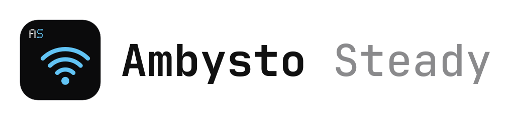

<picture>
  <source media="(prefers-color-scheme: dark)" srcset="docs/brand/ambysto-steady-lockup-dark.svg">
  
</picture>

# Ambysto Steady

*Stable Internet Connection* — a product of Ambysto ([ambysto.com](https://ambysto.com)). The internal name of the repo, data folder and package is still `StableInternet`.

Your Internet drops or lags, and you cannot tell whether the fault is the PC, the router or the Internet service provider (ISP). Software cannot make the Wi‑Fi signal stronger, but Steady measures the connection all the time, recovers it when it drops, and lets you try system optimizations that you can undo.

- **Measure and record** — know whether the fault lies with the PC, the router or the ISP, with data to compare before and after each change.
- **Self-recovery** — detect a hung driver or a lost connection and handle it within seconds, instead of waiting for Windows or acting by hand.
- **Controlled optimization** — each tweak is an on/off toggle; the original value is saved before it is applied, and turning it off puts everything back as it was.

A Windows 10/11 app (Python 3.11+, web UI on `127.0.0.1`) plus a native SwiftUI app for iPhone, iPad and Mac in `apple/`. Apache License 2.0.

## Is it for you?

Yes, if your connection is unstable and you want data on where the fault is, automatic recovery, and tweaks you can switch off again. No, if you expect software to strengthen a weak Wi‑Fi signal. Applying optimizations needs Administrator rights; read-only mode can still monitor.

## Status

Windows version nearing completion. See [docs/ROADMAP.md](docs/ROADMAP.md), [docs/OPEN-QUESTIONS.md](docs/OPEN-QUESTIONS.md) and [CHANGELOG.md](CHANGELOG.md).

- Built: monitor, diagnostics, optimizations with restore, watchdog, failover, desktop UI, packaged build.
- Feature groups:
  - Overview: realtime ping, packet loss and jitter to the router and the Internet, Wi‑Fi signal, 24h history.
  - Optimize: toggles for adapter power saving, PCIe ASPM, wake-on-LAN, TCP, IPv6 and more, see [docs/TWEAKS.md](docs/TWEAKS.md).
  - Diagnostics: drivers and versions available for rollback, channel interference, connection drop history, DNS benchmark and more, see [docs/DIAGNOSTICS.md](docs/DIAGNOSTICS.md).
  - Watchdog: reconnects or restarts the network adapter when a problem is detected, see [docs/WATCHDOG.md](docs/WATCHDOG.md).
  - Log: every incident, optimization change and watchdog action.
- Apple app (iPhone, iPad, Mac): see [apple/README.md](apple/README.md).

## What is in the repo

| Path | What |
|---|---|
| `CHANGELOG.md` | Change history by version |
| `CONTRIBUTING.md` | Code and commit conventions, adding new tweaks |
| `CLAUDE.md` | Guidance for AI agents working in the repo |
| `docs/` | `ARCHITECTURE.md` (architecture, modules, API, data flow), `UI-DESIGN.md` (UI direction, draft), `TWEAKS.md` (toggle catalog: values, risks, how to restore), `DIAGNOSTICS.md` (check catalog and thresholds), `WATCHDOG.md` (self-recovery logic and safety limits), `SECURITY.md` (security model of the server running with Admin rights), `BASELINE.md` (the PC's state before optimizing), `EXPERIMENT-LOG.md` (configuration changes and observed results), `ROADMAP.md` (phased plan), `OPEN-QUESTIONS.md` (points to decide) |
| `docs/adr/` | Architecture Decision Records |
| `app/` | Python source code (backend) |
| `web/` | UI (HTML/CSS/JS) |
| `apple/` | iPhone, iPad and Mac app (SwiftUI), see [apple/README.md](apple/README.md) |
| `spec/diagnosis/` | Diagnosis test vectors shared by every platform |
| `scripts/` | Utility scripts (launcher, installation) |
| `tests/` | Tests |
| `data/` | Runtime data (not committed): settings, metrics |

Start the documentation from [docs/ARCHITECTURE.md](docs/ARCHITECTURE.md). All architectural decisions are recorded in [docs/adr/](docs/adr/).

## How to run

Requires Windows 10/11 and Python 3.11+. Administrator rights are needed to apply optimizations.

Run the monitor alone in the foreground (read-only, no Admin needed) and stop it with Ctrl+C:

```powershell
python -m app.monitor
```

**Packaged build (no Python installation needed):** `pip install -r requirements.txt pyinstaller==6.22.3` then `python scripts/build.py [--smoke]` → `dist/Ambysto Steady/` and `dist/StableInternetConnection-<version>-win64.zip`. Users unzip it and double-click `Ambysto Steady.exe` → the app offers to install for all users of the PC (one Administrator approval): it copies itself to `Program Files`, the monitor runs with Windows for that user, a Start menu shortcut + tray icon at sign-in, and it is listed in Apps & features. An earlier per-user copy (`%LOCALAPPDATA%\Programs`) is replaced; measurements, settings and backups carry over. Uninstall from Apps & features: restores every optimization to its original value, then removes the task, shortcuts and folder (one UAC prompt); asks whether to delete the data. Started from the unzipped folder, it always offers to install; `"Ambysto Steady.exe" desktop` runs it there without installing, to monitor and diagnose, but it does not change Windows settings from there ([ADR-0019](docs/adr/0019-per-machine-install.md)).

**App window + tray icon:** `pip install -r requirements.txt` (pywebview, pystray, Pillow) then double-click `scripts\desktop\run_desktop.pyw` (or `pythonw -m app.desktop`, add `--minimized` to show it only in the tray). Closing the window only hides it to the tray; the monitor runs separately and is not stopped. The tray menu's "Floating monitor" opens a one-line always-on-top bar (Optimize, download, upload, ping) that expands into a table with a heart-monitor style chart, the apps holding connections, and the connection's basic facts.

Data is written to `data/metrics.db`. The monitor also serves the **UI** at `http://127.0.0.1:47613/` (accessible only from this machine; see `docs/SECURITY.md`): Overview, Optimize, Diagnostics, Log, Settings — 7 languages, light/dark, responsive down to phone size.

The Apple app builds and runs from Xcode on a Mac; see [apple/README.md](apple/README.md).

## Limits

- Releases are **not code-signed**, so Windows SmartScreen may warn on the first launch: choose **More info** → **Run anyway**.
- Optimizations need Administrator rights; without them the app can only monitor.

## Privacy

- [Privacy policy](https://steady.ambysto.com/privacy) (source: [PRIVACY.md](PRIVACY.md)) — no data collection; lists every connection the app makes.

## Check

```powershell
python -m unittest discover -s tests -t .
```

## Licence

Copyright (C) 2026 Ambysto. Released under the **Apache License 2.0**, see [LICENSE](LICENSE) and [NOTICE](NOTICE). Contributing: see [CONTRIBUTING.md](CONTRIBUTING.md) and [CLA.md](CLA.md).
